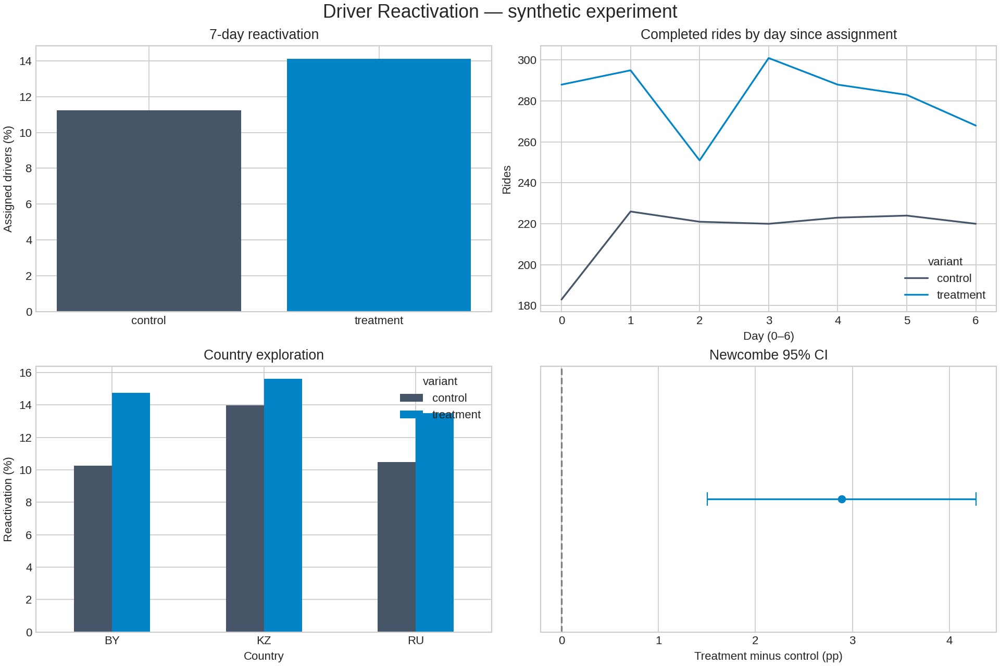
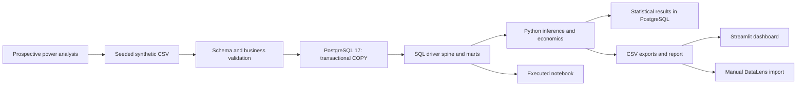
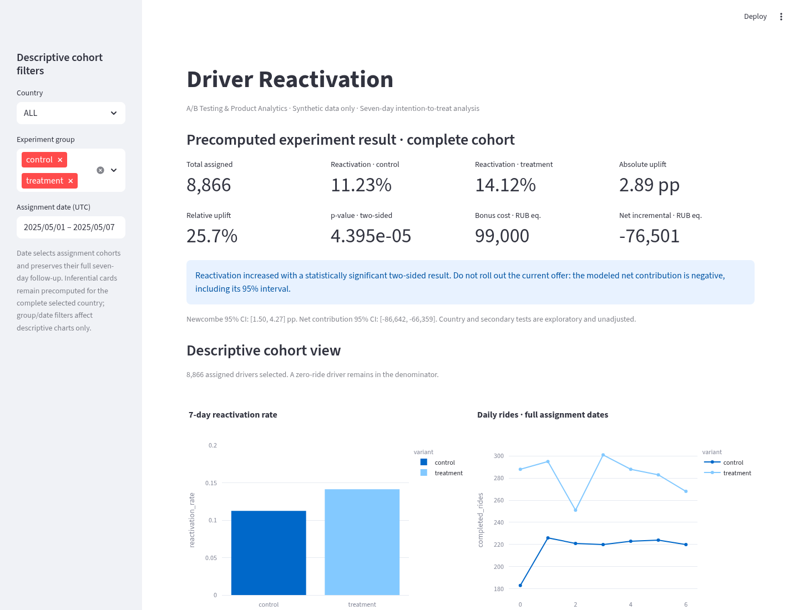

# Driver Reactivation — A/B Testing & Product Analytics Dashboard

**Synthetic experiment · PostgreSQL 17 · Python · SQL · Streamlit · DataLens-ready CSV**

A reproducible product analytics case study: does a 300 RUB-equivalent bonus for completing at least three rides in seven days reactivate inactive drivers profitably? All participants and events are simulated; this is not an experiment on real users or a claim about any company.



## Project Overview

The project implements prospective sample-size planning, seeded relational data generation, strict data-quality validation, a transactional PostgreSQL load, SQL analytics, statistical inference, an executed notebook, automated tests and an interactive dashboard. It intentionally separates simulator assumptions from the analyst's observed-data inputs.

## Business Problem

Inactive drivers reduce available supply. A product team proposes a bonus to encourage their return. More reactivation is useful only if additional platform contribution covers incentives and other costs. The decision therefore combines a confirmatory reactivation endpoint with a transparent economic model.

## Hypothesis

- Business hypothesis: a bonus increases seven-day reactivation and generates positive incremental contribution.
- Statistical H0: treatment and control reactivation probabilities are equal.
- Statistical H1: the probabilities differ. The pre-specified test is two-sided; a positive estimate is needed to claim an increase.

## Experiment Design

| Parameter | Pre-specified value |
| --- | --- |
| Eligibility | No completed rides in the 30 days before assignment |
| Unit | Driver, intention-to-treat |
| Allocation | Complete randomization with fixed 1:1 group sizes, shuffled before outcomes |
| Control | No incentive offer |
| Treatment | 300 RUB-equivalent after at least 3 completed rides in the window |
| Window | `[assigned_at, assigned_at + 7 days)` |
| Extraction | 2025-05-16 00:00 UTC; every assignment has mature follow-up |
| Primary | At least one completed ride per assigned driver |
| Secondary | Rides/assigned driver, completed rides, revenue, bonus cost, contribution |
| Baseline / MDE | 12% / +2 percentage points |
| Alpha / power | 0.05 two-sided / 80% |
| Required sample | 4,433 per group; 8,866 total |
| Simulation seed | 42, fixed before results |

[Prospective plan](reports/analysis_plan.json) is written before data generation. The initial rough estimate of 20,000 participants is superseded by the calculated power requirement, using the arcsine proportion effect size and an equal-arm normal approximation. There is no post-hoc sample-size or seed search. MDE is a planning input, not a minimum observed effect required for significance.

## Dataset Description

| Table | Rows in the seeded run | Key and purpose |
| --- | ---: | --- |
| drivers | 8,866 | driver_id, country RU/KZ/BY, registration |
| experiment_assignments | 8,866 | one assignment per driver |
| rides | 12,626 | completed rides, including historical and out-of-window events |
| bonus_payments | 330 | one qualifying payment per eligible treatment driver |

Source CSVs are generated locally and ignored by Git. Dashboard marts are versioned. Old rides establish simulated history; all assigned drivers satisfy inactivity. Zero-ride drivers remain in every experiment denominator. Revenue is platform commission in RUB-equivalent across countries, not ride GMV or profit. No personal data or real exchange rates are used. See [data guide](data/README.md).

## Data Architecture



The pipeline independently reconciles SQL results with pandas at driver grain, then checks SQL uplift and economics against Python inference. Row-count checks and constraints run on load. Repeated loads replace this simulation in one transaction and clear stale statistics. Use a **dedicated local database**: this is not an incremental production loader.

## SQL Analytics

- [Schema](sql/01_schema.sql): PK/FK/NOT NULL/CHECK constraints and driver/time indexes.
- [Core metrics](sql/02_metrics.sql): assignment spine with LEFT JOIN, independent ride/payment aggregations, ITT denominators, GROUP BY, CTE, FILTER and scalar effect calculations.
- [Segments](sql/03_segment_analysis.sql): country metrics, logically scoped HAVING for bonus qualification, INNER JOIN, ROW_NUMBER for the third ride milestone.
- [Dashboard marts](sql/04_dashboard_marts.sql): seven-day exposure spine, CASE WHEN for active drivers, LAG for daily changes and SUM OVER for cumulative rides. Python inference is loaded into statistical_results.

Views are rebuilt by the pipeline. The primary denominator never depends on a ride existing. Payments are not joined to individual rides, which would multiply both costs and event counts.

## Statistical Methodology

Primary inference is a pooled two-proportion z-test and a Newcombe 95% interval for the treatment-minus-control rate difference (Wilson score construction). Exact balanced allocation makes overall SRM chi-square p=1 structurally; it serves as a post-load integrity diagnostic, not independent proof of sound randomization. Welch comparisons use driver-level observations for secondary mean rides and contribution; zeroes are included.

Country and secondary tests are exploratory and unadjusted for multiple comparisons. A segment ranking does not establish treatment heterogeneity. There is no claim of 28-day retention from a seven-day window. Full methodology, distributions, validation and calculated conclusions are in the [executed notebook](notebooks/ab_analysis.ipynb) and [experiment report](reports/experiment_report.md).

## Results

These are actual outputs from the fixed-seed run, not targets embedded in the analysis.

| Metric | Control | Treatment |
| --- | ---: | ---: |
| Assigned drivers | 4,433 | 4,433 |
| Reactivated drivers | 498 | 626 |
| Seven-day reactivation | 11.23% | 14.12% |
| Completed rides in window | 1,517 | 1,974 |
| Mean rides/assigned driver | 0.3422 | 0.4453 |
| Bonus cost, RUB-equivalent | 0 | 99,000 |

Absolute uplift: **2.887 pp**; relative uplift: **25.70%**. Newcombe 95% CI: **[1.503, 4.273] pp**. Two-sided primary p-value: **4.39484e-05**. CSVs preserve full precision.

## Business Impact

Contribution before incentives is assumed to be 40% of commission revenue. Incremental commission is 56,248.08 RUB-equivalent; incremental contribution before bonus is 22,499.23. Subtracting 99,000 in bonuses yields **-76,500.77 RUB-equivalent**, with a driver-level Welch 95% CI of **[-86,642.43, -66,359.10]** for the treatment population.

**Recommendation: do not roll out this offer under the modeled economics.** Reactivation increases significantly, but the estimated incremental contribution is negative, including the entire interval. Lower bonuses can appear profitable when behavior is held fixed; that sensitivity is not a causal forecast and requires a new experiment. Country results remain exploratory. Follow-up should test incentive levels, sustained 28-day activity, fraud and real unit margins.

## Dashboard



The local Streamlit/Plotly app includes eight KPI cards, group and country rates, a daily rides series, a segment table, a confidence interval chart, economic sensitivity, country/group/assignment-date filters and CSV download. Inferential cards use precomputed complete-cohort results; arbitrary group/date filters apply only to descriptive views. Daily aggregate charts clearly keep full assignment dates.

[DataLens guide](dashboard/README.md) documents each dataset, graph, aggregation rule, selector scope and manual CSV import. **No hosted DataLens dashboard is claimed.** A local database is not accessible to DataLens via localhost; no public database exposure or cloud account is required.

## Limitations

- Synthetic data validate an analytical workflow, not the effectiveness of a real business intervention.
- The generator assumes independent drivers, no spillovers and complete observation; the seed is one simulation, not repeated empirical evidence.
- The 40% margin, RUB-equivalent values and response model are assumptions; sampling intervals omit model uncertainty, fraud and opportunity costs.
- Short-term reactivation is not long-term retention; no lifetime-value or production profitability claim is made.
- Country/secondary comparisons are exploratory, unadjusted and not independently powered for rollout decisions.
- CSV exports are replaceable snapshots. If a pipeline step fails, fix the error and rerun before using previous artifacts; errors exit nonzero.
- No external BI publication or GitHub Actions run has been performed. The workflow file is supplied; local equivalent checks are verified.

## Reproducibility

Requires Python 3.11+ (validated on 3.12), Docker with Compose v2 and a free local port 5433. Run commands from this checkout. No Git worktree is needed.

```bash
python3 -m venv .venv
source .venv/bin/activate
python -m pip install -r requirements.txt
cp .env.example .env
# Edit .env: choose a local POSTGRES_PASSWORD; never commit .env.
docker compose up -d --wait
python -m src.run_pipeline
RUN_POSTGRES_TESTS=1 python -m pytest -q
python scripts/execute_notebook.py
python -m streamlit run dashboard/app.py --server.address 127.0.0.1
```

For a shell-free random local password, run `python scripts/init_local_env.py` instead of copying/editing `.env`. It refuses to overwrite an existing file. These credentials are for the local development database only.

`make db pipeline` runs data preparation after installation/configuration; `make test notebook dashboard` runs the corresponding steps. Set `RUN_POSTGRES_TESTS=1` for database integration tests; without it, those tests are explicitly skipped. Do not call a skipped integration run a full pass. The dashboard can run from versioned marts without PostgreSQL. PostgreSQL is required to regenerate SQL exports and run integration tests; no alternate engine is substituted.

Optional: `python -m src.generate_data` creates only the plan and raw data; `python -m src.validate_data` checks them; `python -m src.load_to_postgres` loads them and resets statistical results. Run the full pipeline to refresh all downstream artifacts. `docker compose stop` stops the database and preserves its volume; no volume deletion is required. Changing the password for an existing initialized volume requires PostgreSQL role management, not just editing .env.

Current validation: **34 pytest tests passed**, including real PostgreSQL boundary/aggregation/constraint fixtures and Streamlit filter checks; **6 notebook code cells executed**. [Machine-readable data validation](reports/validation.json) records source hashes and dependency versions. [JUnit results](reports/pytest.xml) record the test run. Requirements pin runtime libraries; `requirements.lock.txt` records the complete validated Python 3.12 environment; all timestamps are UTC. A second pipeline run is checked for equal artifact hashes and no duplicated records.

### GitHub publication

Review `git status` and confirm `.env` and `.venv` are ignored. Inspect generated CSVs (synthetic only), then commit the project and open a pull request or push to a branch you control:

```bash
git switch -c feature/driver-reactivation
git add .
git diff --cached --stat
git commit -m "Build reproducible driver reactivation analytics project"
git push -u origin feature/driver-reactivation
```

These publication commands are instructions; no remote changes were made by this task. Set the repository description, add analytics/ab-testing/postgresql topics, and link the notebook and local dashboard screenshot in the GitHub project overview. CI will run after publication.

## Tech Stack

Python, pandas, NumPy, SciPy, statsmodels, matplotlib, PostgreSQL 17, psycopg COPY, Docker Compose, pytest, Jupyter, Streamlit, Plotly, DataLens-ready CSV, GitHub Actions.

See [project file inventory](reports/file_inventory.md) and [resume bullets](reports/resume_bullets.md).
